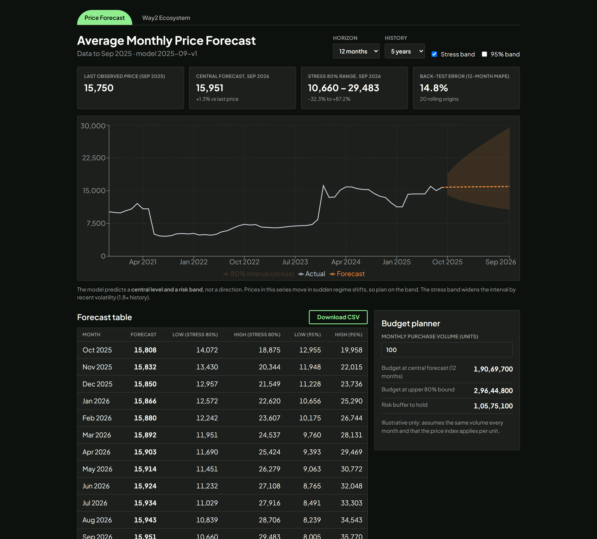
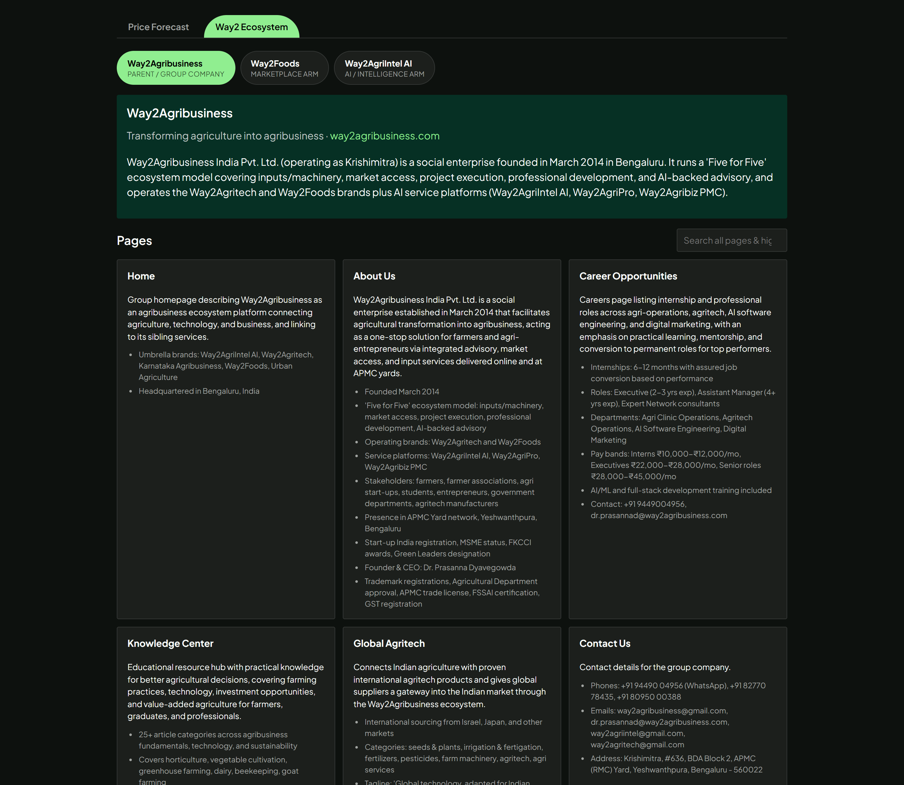

<div align="center">

# 📈 Price Forecast

**A commodity price-forecasting dashboard — from notebook to model to API to UI.**




</div>

A notebook trains the model, a FastAPI service serves it, and a React dashboard presents it in two views: the forecast itself, and a companion directory of the Way2Agribusiness ecosystem (Way2Agribusiness, Way2Foods, Way2AgriIntel).

## ✨ Features

- **Central forecast + risk band** — predicts a price level and a range, not a direction, because this series moves in sudden regime shifts.
- **Stress & 95% bands** — the stress band widens the interval by recent volatility; toggle either on the chart.
- **Back-tested accuracy** — 12-month MAPE shown alongside the forecast (20 rolling origins).
- **Forecast table + CSV export** — month-by-month central, 80% stress and 95% bounds.
- **Budget planner** — turn a monthly purchase volume into a central budget, an upper-bound budget and a risk buffer to hold.
- **Way2 Ecosystem tab** — site switcher, intro band, crawled page cards and related services.

## 🖼️ Screenshots

### Price Forecast
KPI cards, history + forecast chart with uncertainty band, forecast table and budget planner.


### Way2 Ecosystem
Site switcher, dark-green intro band, page cards and related-services chips.



> Theme follows the Way2AgriIntel brand: lime (`#90EE90`) for primary actions and active states, deep forest green (`#063024`) for band sections, Plus Jakarta Sans throughout.

## What's in here

| Folder / file | What it is |
|---|---|
| `price_forecast.ipynb` | The submission notebook (analysis, model, forecast, Q4–Q9 write-ups) |
| `price_data.csv` | The only dataset used |
| `price_model.joblib/json`, `forecast_next_12_months.csv` | Model artifact + forecast produced by the notebook |
| `backend/main.py` | FastAPI service that serves the artifact (`/v1/forecast`, `/v1/history`, `/v1/model`, `/health`) |
| `frontend/` | React + TypeScript (Vite + Recharts) dashboard — Price Forecast tab + Way2 Ecosystem tab |
| `frontend/src/data/way2content.json` | Crawled content for the Way2 Ecosystem tab (Way2Agribusiness, Way2Foods, Way2AgriIntel) |
| `tests/` | 305 notebook tests + backend API tests; reports: `UNIT_TEST_REPORT.md`, `INTEGRATION_TEST_REPORT.md`, `BREAKDOWN_SUMMARY_REPORT.md` |
| `run.ps1` / `run.sh` | Start both servers at once (PowerShell / Git Bash) |

## Run the app

**One command (after the one-time setup below):**
```powershell
.\run.ps1        # PowerShell
```
```bash
./run.sh         # Git Bash
```
This starts the API on :8000 and the UI on :5173, installing `frontend/node_modules` and creating `frontend/.env` on first run.

**One-time setup:**
```powershell
python -m venv venv
.\venv\Scripts\python.exe -m pip install -r requirements.txt
```

**Or run each piece by hand** — Terminal 1 (API, from the project root, not from inside `backend/`):
```bash
python -m pip install -r requirements.txt
python -m uvicorn backend.main:app --reload --port 8000
```
Terminal 2 (React UI):
```bash
cd frontend
cp .env.example .env
npm install
npm run dev
```
Open http://localhost:5173 (API health check: http://localhost:8000/health).

## Verify
```bash
cd frontend && npm run typecheck && npm test && npm run build
python -m pytest
```

## Production note
The browser should call the **Django gateway** (JWT auth, rate-limit), which calls this FastAPI service with `REQUIRE_KEY=1` and `SERVICE_KEY`. In the UI, only `frontend/src/api.ts` (`API_URL`, `authHeaders()`) changes.
